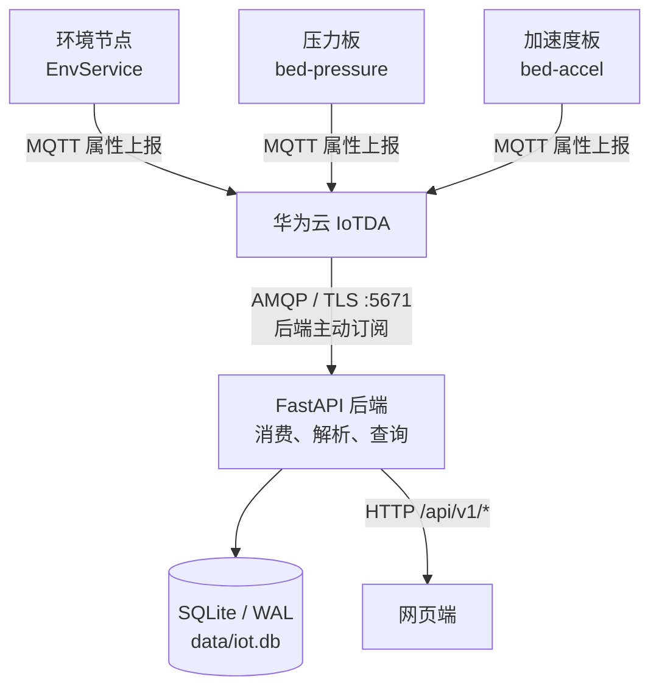

# BearPi 睡眠环境调节与卧床行为监测系统

> 基于 **BearPi-HM Nano + 华为云 IoTDA + FastAPI + SQLite** 的环境与卧床行为监测原型。
> 当前处于设备联调与需求收敛阶段，本说明以后端实际代码为准。


---

## 项目简介

系统由环境节点、压力板、加速度板、华为云 IoTDA 和后端服务组成：

- **环境节点（EnvService）**：采集温度、湿度、光照和环境状态。
- **压力板（bed-pressure）**：采集床位状态、负载判定、置信度、两路压力与状态事件。
- **加速度板（bed-accel）**：采集三轴加速度、运动状态、近 10 秒体动次数和运动峰值。
- **后端服务**：通过 AMQP 主动消费 IoTDA 属性上报，写入 SQLite，并向网页提供查询接口。
- **网页端**：展示设备在线状态、最新数据、历史曲线、卧床状态和体动记录。

本项目是环境与行为的记录展示原型，**不提供医疗诊断、睡眠分期或睡眠质量医学评分**。

## 系统架构



另有备用入口 `POST /iot/callback`，当前仅校验签名并打印日志，**不会写入数据库**。

## 当前能力

| 模块 | 状态 | 说明 |
|------|------|------|
| AMQP 消费 | 已实现 | 自动重连，退避间隔 1–15 秒；消息处理失败不中断消费循环 |
| 数据入库 | 已实现 | 按服务写入两张宽表，自动建库建表，类型转换失败写 `NULL` 并告警 |
| 设备发现 | 已实现 | 从真实上报中的 `device_id` 自动派生设备清单，无独立设备注册表 |
| 在线状态 | 已实现 | 最近一次接收时间超过 60 秒判为离线 |
| 查询接口 | 已实现 | 设备、最新数据、单指标历史、卧床状态、体动记录，共 5 个 GET 接口 |
| 异常响应 | 已实现 | 统一 `{code, message, data}`，参数错误 400、不存在 404、服务器错误 500 |
| 真实在床判断 | 已实现（初版） | `bed_state` 直接取压力板上报的 `bedState`，不再用在线状态近似 |
| 体动片段 | 待完善 | 当前按 `motionState = MOVING` 的记录返回，尚未合并为一次完整动作 |
| 传感器故障 | 已接入字段 | `sensorStatus` 已入库；压力板可能为 `ADC_FAULT`，加速度板当前恒为 `OK` |
| 风扇闭环 | 未提供 | 当前无命令下发、规则引擎、控制记录或风扇接口 |

## 快速开始

### 1. 环境要求

- Python **3.14+**
- [uv](https://docs.astral.sh/uv/)
- 如需连接真实 IoTDA，还需有效的 AMQP 接入凭证

`python-qpid-proton` 固定为 **0.39.0**，以使用 Windows 预编译 wheel，避免本地 MSVC 编译依赖。

### 2. 安装与配置

```powershell
# 安装依赖
uv sync

# 创建本地配置
Copy-Item .env.example .env
```

编辑 `.env`，填入 IoTDA 应用侧接入凭证。若只启动查询 API，可暂不填写；缺少 AMQP 必填配置时，服务会告警并跳过订阅。

### 3. 启动服务

```powershell
uv run fastapi dev src/backend/main.py
```

启动后访问：

- Swagger UI：<http://127.0.0.1:8000/docs>
- OpenAPI JSON：<http://127.0.0.1:8000/openapi.json>

仅运行 AMQP 消费者：

```powershell
uv run python -m backend.amqp
```

## 配置项

配置优先级：**系统环境变量 > `.env`**。

| 环境变量 | 必填 | 默认值 | 用途 |
|----------|------|--------|------|
| `AMQP_HOST` | 连接云端时必填 | 无 | IoTDA 实例 AMQP 接入域名 |
| `AMQP_PORT` | 否 | `5671` | AMQP 端口 |
| `AMQP_ACCESS_KEY` | 连接云端时必填 | 无 | IoTDA 应用侧接入凭证 AccessKey |
| `AMQP_ACCESS_CODE` | 连接云端时必填 | 无 | IoTDA 应用侧接入凭证 AccessCode |
| `AMQP_QUEUE` | 否 | `DefaultQueue` | AMQP 订阅队列名 |
| `AMQP_INSTANCE_ID` | 多实例时填写 | 空 | 标准版同 Region 多实例 ID |
| `SQLITE_PATH` | 否 | `data/iot.db` | SQLite 文件路径，支持绝对路径和 `~` |

> AccessKey / AccessCode 不是 IAM 的 AK/SK。凭证类型错误通常会导致 `amqp:unauthorized-access`。

## 设备上报协议

设备 ID 使用 IoTDA 消息中的真实值，不在后端硬编码。同一类设备共用对应宽表，通过 `device_id` 区分。

### EnvService

| 上报属性 | 入库字段 | 类型/含义 |
|----------|----------|-----------|
| `temperature` | `temperature` | 温度，℃ |
| `humidity` | `humidity` | 相对湿度，%RH |
| `light` | `light` | 光照，lux |
| `env_status` | `env_status` | 环境节点状态码，具体枚举待设备侧确认 |

### BedMonitor（压力板 + 加速度板）

两台设备共用服务标识 `BedMonitor`，通过 `device_id` 区分；属性在平台侧只建一份，设备只上报自己那部分，缺失字段写 `NULL`，不视为异常。

**压力板 `bed-pressure`（14 项）**

| 上报属性 | 入库字段 | 类型/含义 |
|----------|----------|-----------|
| `bedState` | `bed_state` | 床位主状态：`OUT_BED` / `IN_BED_UNKNOWN` / `LYING` / `SITTING` / `UNKNOWN` |
| `loadPresence` | `load_presence` | 负载判定：`PRESENT` / `UNCERTAIN` / `ABSENT` |
| `confidence` | `confidence` | 置信度：`HIGH` / `MEDIUM` / `LOW` |
| `lastEvent` | `last_event` | 最近事件：`BED_IN` / `BED_OUT` / `SIT_UP` / `LIE_DOWN` / `NONE` |
| `alertType` | `alert_type` | 提示类型：`LONG_STILL` / `LONG_SITTING` / `OUT_BED_TIMEOUT` / `SENSOR_FAULT` / `NONE` |
| `sensorStatus` | `sensor_status` | 自检状态：`OK` / `ADC_FAULT` |
| `headShoulderRaw` | `head_shoulder_raw` | 头肩路 ADC 原始码，未减基线 |
| `headShoulderNet` | `head_shoulder_net` | 头肩路净压，负数截零 |
| `waistHipRaw` | `waist_hip_raw` | 腰臀路 ADC 原始码，单路阶段恒为 0 |
| `waistHipNet` | `waist_hip_net` | 腰臀路净压，单路阶段恒为 0 |
| `totalNetPressure` | `total_net_pressure` | 两路净压之和 |
| `waistHipRatio` | `waist_hip_ratio` | 腰臀净压占总净压的比例，0–1 |
| `lastEventSec` | `last_event_sec` | 最近事件发生在开机后第几秒 |
| `runSec` | `run_sec` | 开机至今秒数，用于判活 |

**加速度板 `bed-accel`（8 项）**

| 上报属性 | 入库字段 | 类型/含义 |
|----------|----------|-----------|
| `accelX` / `accelY` / `accelZ` | `accel_x` / `accel_y` / `accel_z` | 三轴加速度原始值，2048 码约 1g |
| `motionPeakMg` | `motion_peak_mg` | 近 10 秒三轴合成运动峰值，单位 0.001g |
| `motionState` | `motion_state` | 运动状态：`STILL` / `MOVING` |
| `motionCount10s` | `motion_count_10s` | 近 10 秒进入体动的次数，上限 500 |
| `sensorStatus` | `sensor_status` | 当前恒为 `OK` |
| `runSec` | `run_sec` | 开机至今秒数，用于判活 |

两条公共时间字段：

- `event_time`：优先使用服务或消息中的平台事件时间；IoTDA 的 `yyyyMMddTHHmmssZ` 会统一转成带时区的 ISO 8601，缺失时使用后端当前时间。
- `received_at`：后端接收入库时生成，用于在线判定和最后上报时间。

字段映射集中在 `src/backend/storage.py` 的 `SERVICE_TABLES`。新增属性时还需同步数据库列和接口文档，不能只修改设备上报代码。

## 前端查询接口

统一前缀：`/api/v1`。

| 方法 | 路径 | 主要参数 | 用途 |
|------|------|----------|------|
| GET | `/devices` | 无 | 设备列表、类型、在线状态和最后上报时间 |
| GET | `/devices/{device_id}/latest` | 路径设备 ID | 最新环境与床体数据；无另一类数据时对应字段为 `null` |
| GET | `/devices/{device_id}/history` | `metric` 必填；`start`、`end`、`points` 可选 | 单指标历史曲线，默认最多返回 200 个降采样点 |
| GET | `/bed/state` | `device_id` 可选 | `bedState` 原值 + 压力板/加速度板最新帧，缺失侧为 `null` |
| GET | `/bed/events` | `device_id`、`start`、`end`、`limit` 可选 | 运动状态上报记录，默认最多 50 条 |

历史指标白名单：

```text
temperature · humidity · light · env_status
accel_x · accel_y · accel_z · motion_peak_mg · motion_count_10s
head_shoulder_raw · head_shoulder_net · waist_hip_raw · waist_hip_net
total_net_pressure · waist_hip_ratio · run_sec · last_event_sec
```

示例：

```http
GET /api/v1/devices/env-01/history?metric=temperature&points=200
```

成功响应：

```json
{
  "code": 0,
  "message": "ok",
  "data": {}
}
```

错误响应中的 `code` 等于 HTTP 状态码，`data` 为 `null`。详细字段、空值规则和请求示例见[前端接口文档](document/API_Reference_V0.1.md)。

## 项目结构

```text
项目根/
├── document/                         # 需求、接口与联调文档
│   ├── Requirements_Specification_V0.2.md
│   ├── API_Reference_V0.1.md
│   ├── Member_1_2_3_Action_Items_V0.1.md
│   ├── Known_Issues_V0.1.md
│   └── Code_Changes_V0.1.md
├── src/backend/
│   ├── main.py                       # FastAPI 入口、路由与统一异常处理
│   ├── amqp.py                       # AMQP 消费、消息解析与自动重连
│   ├── storage.py                    # SQLite 表结构、入库与查询函数
│   └── routers/
│       ├── api.py                    # /api/v1 前端查询接口
│       └── iot.py                    # /iot/callback 备用签名校验入口
├── data/iot.db                       # 运行时数据库（不提交 Git）
├── .env.example                      # 配置模板
├── pyproject.toml                    # Python 与依赖配置
└── uv.lock                           # 锁定依赖版本
```

## 文档导航

| 文档 | 用途 |
|------|------|
| [需求规格说明书](document/Requirements_Specification_V0.2.md) | 功能、非功能需求及验收基线；文件名保留 V0.2，文档内部为 v0.3 |
| [前端接口文档](document/API_Reference_V0.1.md) | 五个查询接口的字段、参数、示例及前端接入注意事项 |
| [成员 1、2、3 补充事项](document/Member_1_2_3_Action_Items_V0.1.md) | 节点协议、心跳、异常处理和联调任务清单 |
| [待修正问题清单](document/Known_Issues_V0.1.md) | 已知问题、影响、负责人和修复状态 |
| [代码变更记录](document/Code_Changes_V0.1.md) | 风扇相关脚手架移除范围及当前实现边界 |

> 需求文档中风扇、规则表和控制记录的部分描述尚未同步回退；这些功能以代码变更记录和当前源码为准。

## 联调排查

| 现象 | 优先检查 |
|------|----------|
| 启动时提示跳过 AMQP 订阅 | `.env` 是否存在，`AMQP_HOST / ACCESS_KEY / ACCESS_CODE` 是否完整 |
| 报 `amqp:unauthorized-access` | 是否误用 IAM AK/SK；多实例是否缺少 `AMQP_INSTANCE_ID` |
| 设备列表为空 | 设备清单来自成功入库的读数，确认已收到并保存真实上报 |
| 有消费日志但数据库无记录 | 检查 service 和属性名是否匹配 `SERVICE_TABLES`，查看“未知服务/未映射属性”告警 |
| 床体数据为空 | 平台服务标识需为 `BedMonitor`，属性名与协议表逐字一致；旧名 `BedService` 已不再入库 |
| 静置床体被显示为离线 | 两台设备是否按 2 秒周期上报；超过 60 秒无新数据会判离线 |
| 时间范围查询漏数据 | 确认真实 `event_time` 是带时区的 ISO 8601，而不是未转换的 Unix 时间戳 |
| 前端浏览器跨域失败 | 当前未配置 CORS，开发环境优先使用前端开发服务器代理 |

## 安全说明

- `.env`、数据库和虚拟环境已加入 `.gitignore`，真实凭证不得提交仓库。
- `/api/v1/*` 当前没有鉴权，也未配置 CORS，仅限可信局域网内联调。
- 回调 Token 当前仍在源码中配置，备用接口生产化前需改为环境变量并完善 payload。
- AMQP 当前使用 `ANONYMOUS_PEER`，与官方示例一致；生产部署应改为证书校验并配置 CA。
- 凭证泄露后应立即在 IoTDA 控制台删除并重新生成。

## 下一步

1. 获取两台设备的真实 ID、上报样例、状态枚举和时间格式。
2. 为床体增加周期心跳，完成静置、体动、断网和传感器异常联调。
3. 接入第二路压力传感器，补全 `LYING` / `SITTING` 判断，并为两台设备增加时间窗合并。
4. 增加推送幂等去重，并确定连续体动记录的片段合并规则。
5. 由全组确认是否重新实施完整风扇闭环，再同步需求、硬件和后端开发。
